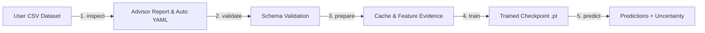

# Modular Chemistry Machine-Learning Framework

[](https://www.python.org/downloads/)
[](https://opensource.org/licenses/MIT)
[](https://pytorch.org/)
[](https://www.rdkit.org/)

**A modular, feature-aware machine-learning framework for chemistry and drug discovery.** 
Designed as an extensible platform for molecular property prediction, ADMET profiling, and thermochemistry — seamlessly combining **Graph Neural Networks (D-MPNN, GIN)**, **Handcrafted & Tabular Descriptors**, **Physics/Empirical Priors**, **Deep Ensembles**, **Evidential Uncertainty Quantification**, and an **Automated Data Quality Advisor**.

---

## 📑 Tài liệu liên quan
- 📊 [**Hướng dẫn Phân tích Đặc trưng & Đọc Báo cáo (Analysis Guide)**](ANALYSIS_GUIDE.md): Chi tiết cách khảo sát dữ liệu, phân tích đặc trưng, tính điểm sức khỏe dữ liệu (Health Score), và đọc báo cáo.
- 🏗️ [**Kiến trúc Chuyên sâu của Hệ thống (Architecture & Deep Dive)**](ARCHITECTURE.md): Chi tiết kiến trúc từng module, thuật toán truyền tin đồ thị, hàm mất mát bất định, và kết quả benchmark ADMET.

---

## ✨ Điểm nổi bật của Framework

1. **Kiến trúc Lai Đa phương thức (Hybrid Multi-Modal Modeling):**
   - Hỗ trợ kết hợp song song biểu diễn đồ thị phân tử (**D-MPNN**, **GIN**) và nhánh mạng nơ-ron đa tầng (**MLP Descriptors**) qua các chiến lược hợp nhất (*Concat*, *Additive*, *Gated*).
2. **Đột phá Kiến trúc GNN với Global Virtual Supernode & Attention Pooling:**
   - Tích hợp `virtual_node: true` triệt tiêu điểm nghẽn nén ép thông tin (**over-squashing**) trên khung phân tử lớn bằng nút siêu việt toàn cục $O(1)$, kết hợp cơ chế **Graph Attention Pooling** (`aggregation: attention`) tự động gán trọng số cao cho các pharmacophore quyết định hoạt tính.
3. **Loss Functions & Metrics Chuyên dụng cho Khám phá Thuốc (Drug Discovery):**
   - **Focal Loss** (`loss: focal`): Khắc phục triệt để tình trạng mất cân bằng lớp cực đoan (1–5% binder dương tính) trong sàng lọc bioassay.
   - **Pairwise Ranking Loss** (`loss: pairwise_ranking`): Tối ưu trực tiếp khả năng xếp hạng và làm giàu hợp chất (virtual screening enrichment) kèm hệ số tương quan hạng **Spearman** (`metrics: [spearman]`).
4. **Trí tuệ Dược lý & Chọn Lọc Đặc trưng Tự động (Pharmacophore Intelligence):**
   - Hỗ trợ trích xuất Morgan Fingerprint ECFP4/ECFP6 vector hóa siêu tốc (1024/2048-bit), 200+ RDKit 2D physicochemical descriptors và khối `AutoPharmacophoreBlock` tự động chọn lọc Top-$K$ đặc trưng tối ưu trên tập huấn luyện chống data leakage.
5. **Cố vấn Dữ liệu Tự động Nâng cấp (Dataset Advisor v2):**
   - Tự động khảo sát độ đa dạng không gian hóa học (**Tanimoto Chemical Space Diversity**), Bemis-Murcko Scaffold Diversity, phát hiện drift phân phối và tự động kê đơn cấu hình tối ưu (Virtual Supernode, Attention readout, Focal/Ranking loss).
6. **Định lượng Độ bất định (Uncertainty Quantification):**
   - Tích hợp sẵn **Evidential Deep Learning** (phân phối Normal-Inverse-Gamma) và **Deep Ensembles** ($K \ge 3$) cho phép dự đoán giá trị thuộc tính kèm độ không chắc chắn ($\sigma^2$) của từng phân tử.
7. **Hệ thống Đặc trưng Có khả năng Mở rộng (Config-Driven Feature Registry):**
   - Khai báo các khối đặc trưng qua YAML: đếm nguyên tố, cặp liên kết, mẫu SMARTS, nhóm Benson, hoặc hàm Python tùy biến.
8. **Đánh giá Bằng chứng Đặc trưng (Feature Evidence Scorecard):**
   - Tự động sinh báo cáo HTML trực quan và ma trận tương quan PNG giúp kiểm chứng tính ổn định và đóng góp thực tế của từng đặc trưng.

---

## 🚀 Cài đặt

### Cài đặt qua Git:
```bash
git clone https://github.com/soratori1025/Framework-Chemistry.git
cd Framework-Chemistry
pip install -e ".[config,chemistry,benchmark,test]"
```

### Yêu cầu môi trường:
- **Python**: $\ge 3.10$ (khuyến nghị 3.11 hoặc 3.12)
- **PyTorch**: $\ge 2.0$ (CPU hoặc CUDA GPU)
- **RDKit**: $\ge 2023.03$ (xử lý hóa tin học, SMARTS, Scaffold split)
- **PyTDC**: (tùy chọn, dùng để tải tập dữ liệu chuẩn Therapeutics Data Commons)

Kiểm tra cài đặt:
```bash
pytest tests/
chemistry-framework --help
```

---

## 🔄 Quy trình Làm việc Trọn vẹn (End-to-End Workflow)



### Bước 1: Khảo sát dữ liệu & Tự động sinh cấu hình (`inspect`)
Thay vì phải tự viết file YAML từ đầu, hãy để Advisor khảo sát dữ liệu của bạn, đánh giá rủi ro và tự động xuất ra file cấu hình tối ưu:
```bash
chemistry-framework inspect data/my_compounds.csv \
  --smiles-column smiles \
  --target activity \
  --generate-config configs/my_experiment.yaml \
  --output-dir reports/inspection
```

### Bước 2: Kiểm tra tính hợp lệ của cấu hình (`validate`)
```bash
chemistry-framework validate configs/my_experiment.yaml
```

### Bước 3: Chuẩn bị dữ liệu, chia tập & trích xuất scorecard (`prepare`)
Chia dữ liệu (Scaffold/Random), tính toán ma trận đặc trưng, lưu cache, và xuất báo cáo bằng chứng đặc trưng (HTML, CSV, Heatmap PNG):
```bash
chemistry-framework prepare configs/my_experiment.yaml
```

### Bước 4: Huấn luyện mô hình (`train`)
Huấn luyện mô hình Hybrid, D-MPNN, GIN hoặc Deep Ensemble theo đúng cấu hình:
```bash
chemistry-framework train configs/my_experiment.yaml
```
Kết quả huấn luyện và checkpoint `.pt` sẽ được lưu trong thư mục `checkpoint_dir`.

### Bước 5: Dự đoán cho các phân tử mới (`predict`)
Dự đoán nhãn và độ bất định (variance) cho một tập hợp các phân tử SMILES mới:
```bash
chemistry-framework predict \
  --checkpoint outputs/checkpoints/my_task.pt \
  --input data/screen_candidates.csv \
  --smiles-column smiles \
  --output data/screen_results.csv
```

---

## 🛠️ Hướng dẫn Thiết lập File Cấu hình YAML Cho Dữ Liệu Của Riêng Bạn

Một file cấu hình thử nghiệm chuẩn bao gồm 8 khối chính:

```yaml
name: my-custom-experiment

# 1. KHỐI DATASET: Định nghĩa nguồn dữ liệu
dataset:
  path: data/molecules.csv          # Đường dẫn tới file CSV dữ liệu của bạn
  smiles_column: smiles             # Tên cột chứa chuỗi SMILES
  targets:
    my_target:
      column: target_value          # Tên cột nhãn trong file CSV

# 2. KHỐI FEATURES: Khai báo các khối đặc trưng hóa học bổ sung
features:
  composition:
    type: elements
    elements: [H, C, N, O, S, P, F, Cl, Br, I]
  bonds:
    type: bond_pairs
    elements: [H, C, N, O, S, P, F, Cl, Br, I]
    bond_orders: ["1", "2", "3", "a"]
  aromatic_rings:
    type: smarts
    pattern: "a"
    mode: count

# 3. KHỐI ROUTES: Chỉ định đặc trưng nào đi vào nhánh nào
routes:
  my_target: [composition, bonds, aromatic_rings]

# 4. KHỐI TASKS: Khai báo loại bài toán
tasks:
  my_target:
    target: my_target
    kind: scalar_regression          # hoặc binary_classification
    route: my_target

# 5. KHỐI SPLIT: Chiến lược phân chia tập dữ liệu
split:
  method: scaffold                  # scaffold, random, size, hoặc smarts
  fractions: [0.8, 0.1, 0.1]        # train / val / test
  seed: 42

# 6. KHỐI MODEL: Kiến trúc mạng nơ-ron
model:
  structure:
    encoder: dmpnn                  # dmpnn hoặc gin
    hidden_dim: 128
    depth: 3
    aggregation: mean
    dropout: 0.1
  descriptors:
    enabled: true                   # Bật nhánh MLP xử lý đặc trưng bảng
    hidden_dim: 64
    depth: 1
    dropout: 0.1
  fusion: concat                    # concat hoặc additive
  ffn:
    hidden_dim: 128
    depth: 2
    dropout: 0.1
  head: standard                    # standard, classification, evidential, gaussian

# 7. KHỐI TRAINING: Tham số huấn luyện
training:
  epochs: 50
  batch_size: 64
  learning_rate: 0.001
  loss: huber                       # huber, bce, mse, evidential
  scheduler: cosine                 # cosine hoặc none
  warmup_epochs: 3
  grad_clip: 1.0
  patience: 15                      # Early stopping patience
  ensemble_size: 1                  # > 1 để bật Deep Ensemble (ví dụ: 3)
  device: auto                      # auto, cuda, hoặc cpu
  checkpoint_dir: outputs/checkpoints

# 8. KHỐI EVALUATION & ANALYSIS
evaluation:
  metrics: [mae, rmse, r2]          # hoặc [auroc, auprc, accuracy]
analysis:
  enabled: true
  output_dir: outputs/analysis
cache:
  enabled: true
  directory: .chemistry_cache/features
```

---

## 📋 Mẫu Cấu hình Tiêu biểu Cho Các Bài Toán Thực Tế

### Mẫu 1: Phân loại Nhị phân Mất cân bằng Lớp (Binary Classification)
Phù hợp cho các bài toán phân loại độc tính (Tox) hoặc vượt hàng rào máu não (BBB):
```yaml
name: admet-bbb-classification
dataset:
  path: data/bbb_dataset.csv
  smiles_column: Drug
  targets:
    penetration:
      column: Y
tasks:
  penetration:
    target: penetration
    kind: binary_classification
split:
  method: scaffold
  fractions: [0.8, 0.1, 0.1]
model:
  structure:
    encoder: dmpnn
    hidden_dim: 128
    depth: 3
    dropout: 0.1
  descriptors:
    enabled: true
  head: classification
training:
  epochs: 35
  batch_size: 64
  learning_rate: 0.001
  loss: bce
  scheduler: cosine
  warmup_epochs: 3
evaluation:
  metrics: [auroc, auprc, accuracy]
```

---

### Mẫu 2: Hồi quy Kháng Ngoại lai với Huber Loss (Robust Regression)
Phù hợp cho dự đoán tính thấm Caco-2 hoặc Độ hòa tan (Solubility):
```yaml
name: admet-caco2-regression
dataset:
  path: data/caco2_dataset.csv
  smiles_column: Drug
  targets:
    permeability:
      column: Y
tasks:
  permeability:
    target: permeability
    kind: scalar_regression
split:
  method: scaffold
  fractions: [0.8, 0.1, 0.1]
model:
  structure:
    encoder: dmpnn
    hidden_dim: 64
    depth: 3
    dropout: 0.2
  descriptors:
    enabled: true
    hidden_dim: 64
  head: standard
training:
  epochs: 50
  batch_size: 32
  learning_rate: 0.001
  loss: huber                       # Huber Loss triệt tiêu gradient của outliers
  scheduler: cosine
  warmup_epochs: 3
evaluation:
  metrics: [mae, rmse, r2]
```

---

### Mẫu 3: Định lượng Độ bất định với Evidential Head (Uncertainty Quantification)
Phù hợp cho các tập dữ liệu lớn ($N \ge 1000$) như Lipophilicity:
```yaml
name: lipophilicity-evidential
dataset:
  path: data/lipophilicity.csv
  smiles_column: Drug
  targets:
    logD:
      column: Y
tasks:
  logD:
    target: logD
    kind: scalar_regression
model:
  structure:
    encoder: dmpnn
    hidden_dim: 128
    depth: 3
  descriptors:
    enabled: true
  head: evidential                   # Tự động xuất dự đoán (mean) và độ bất định (variance)
training:
  epochs: 40
  batch_size: 64
  learning_rate: 0.001
  loss: evidential
evaluation:
  metrics: [mae, rmse, r2]
```

---

### Mẫu 4: Deep Ensemble Giảm Phương sai cho Dữ liệu Nhỏ (Deep Ensemble)
Phù hợp cho tập dữ liệu ít mẫu ($N < 800$) hoặc cần độ tin cậy tối đa:
```yaml
name: herg-ensemble
dataset:
  path: data/herg_dataset.csv
  smiles_column: Drug
  targets:
    blocker:
      column: Y
tasks:
  blocker:
    target: blocker
    kind: binary_classification
model:
  structure:
    encoder: gin                    # Sử dụng Graph Isomorphism Network
    hidden_dim: 128
    depth: 4
  descriptors:
    enabled: true
  head: classification
training:
  epochs: 30
  batch_size: 64
  learning_rate: 0.0005
  loss: bce
  ensemble_size: 3                  # Huấn luyện độc lập 3 mô hình và lấy trung bình dự đoán
evaluation:
  metrics: [auroc, auprc, accuracy]
```

---

## 🐍 Sử dụng Framework qua Python API

```python
from chemistry_framework import (
    load_config,
    prepare_experiment,
    build_hybrid_model,
    make_experiment_dataloaders,
    train_model,
    evaluate_model,
)

# 1. Nạp file cấu hình
config = load_config("configs/my_experiment.yaml")

# 2. Chuẩn bị dữ liệu và trích xuất đặc trưng
prepared = prepare_experiment(config)

# 3. Tạo DataLoader
loaders = make_experiment_dataloaders(prepared, "my_target")

# 4. Khởi tạo mô hình Hybrid
model = build_hybrid_model(
    config.model,
    task_kind="scalar_regression",
    out_dim=1,
    descriptor_dim=len(prepared.features.names),
)

# 5. Huấn luyện mô hình
result = train_model(
    model,
    loaders.train,
    loaders.validation,
    config.training,
    checkpoint_path="outputs/model.pt",
)

# 6. Đánh giá trên tập kiểm thử
metrics, actual, predicted = evaluate_model(
    model,
    loaders.test,
    config.evaluation.metrics,
    device=config.training.device,
)
print("Kết quả kiểm thử:", metrics)
```

---

## 📊 Kết quả Benchmark ADMET (Therapeutics Data Commons)

Framework đã được đối sánh và kiểm chứng thực tế trên 4 tập chuẩn ADMET của Therapeutics Data Commons (TDC) sử dụng phân chia nghiêm ngặt **Bemis-Murcko Scaffold Split (80/10/10)**:

| Tập dữ liệu | Nhiệm vụ | Số mẫu | Kiến trúc Tối ưu | Metric Chính (Test Set) |
| :--- | :--- | :---: | :---: | :---: |
| **BBB Martins** | Hàng rào máu não (Phân loại) | 2,030 | D-MPNN Hybrid | **AUROC: 0.884** \| AUPRC: 0.957 |
| **Caco-2 Wang** | Tính thấm tế bào ruột (Hồi quy) | 910 | D-MPNN Hybrid + Huber | **MAE: 0.354** \| RMSE: 0.528 |
| **Lipophilicity** | Ái lực dầu/nước logD (Hồi quy) | 4,200 | D-MPNN + Evidential | **MAE: 0.551** \| RMSE: 0.749 |
| **hERG Blockers**| Độc tính tim mạch (Phân loại) | 648 | GIN Ensemble ($K=3$) | **AUROC: 0.841** \| AUPRC: 0.730 |

Chi tiết thực nghiệm và biểu đồ đối sánh xem tại [ARCHITECTURE.md](ARCHITECTURE.md).

---

## 🧪 Chạy Kiểm thử (Unit Tests)

Bộ kiểm thử bao gồm 46 bài test tự động bao phủ toàn bộ các module:
```bash
pytest tests/ -v
```

---

## 📄 Bản quyền
Phát hành theo giấy phép [MIT License](LICENSE).
Mọi đóng góp, báo lỗi (Issues) và yêu cầu kéo (Pull Requests) đều được hoan nghênh.
